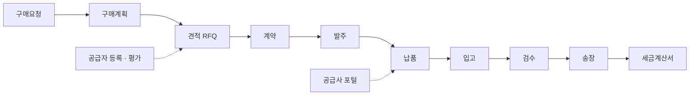

# SRM 구매 관리 솔루션

> Salesforce 기반 구매 관리(SRM) 솔루션. 공급자 등록 요청 개발을 시작으로 SRM 전체를 맡아, 구매요청부터 세금계산서까지의 업무 흐름과 공급사 포털, 리스크, AI 기능까지 개발하고 있습니다.

| 항목 | 내용 |
|---|---|
| 기간 | 2025 – 진행 중 |
| 역할 | SRM 전체 개발 담당 |
| 형태 | 회사 프로젝트 (사내 솔루션 팀) |
| 기술 | Apex, LWC, Experience Cloud, Platform Event, Batch, 2GP Package, Azure OpenAI, MCP |

> 회사 프로젝트를 정리한 문서입니다. 회사 소스 코드와 고객 정보는 포함하지 않습니다.

## 업무 흐름

## 맡은 영역

| 영역 | 한 일 |
|---|---|
| 구매 업무 흐름 | 구매요청 → 구매계획 → 견적 → 계약 → 발주 → 납품 → 입고 → 검수 → 송장 → 세금계산서 전 과정의 화면과 로직 개발, 유지보수 |
| 공급자 관리 | 공급자 등록 요청 화면(단계별 입력), 공급자 평가, 공급사 포털(Experience Cloud) |
| 전자계약 연동 | 발주 확정 시 계약 자동 생성, 최종 서명 시점에 단가 생성과 기간이 겹치는 단가 종료 |
| 권한과 공유 | 검수 담당자 Apex 공유 배치, 포털 사용자 요청은 Platform Event 로 넘겨 권한 있는 컨텍스트에서 공유 생성, 역할별 권한 세트 |
| 모듈 패키징 | 솔루션을 2GP 패키지 16개로 분리 → [srm-modular-packaging](https://github.com/leeyongha2006/srm-modular-packaging) |
| AI 에이전트 · MCP | 말로 구매 업무를 처리하는 에이전트, Apex 로 구현한 MCP 서버 → [srm-ai-agent-mcp](https://github.com/leeyongha2006/srm-ai-agent-mcp) |
| 리스크 · 공급망 | 임원용 대시보드, 공급망 사각지대 탐지 → [srm-risk-supply-chain-dashboard](https://github.com/leeyongha2006/srm-risk-supply-chain-dashboard) |
| 품질 | 기능 명세서 20종 작성, 회귀 테스트 207개 자동화 → [srm-e2e-test-automation](https://github.com/leeyongha2006/srm-e2e-test-automation) |

## 배운 점

- 한 화면이 아니라 **구매요청부터 세금계산서까지 이어지는 흐름**을 맡으면서, 한 단계의 변경이 다음 단계 데이터와 권한에 어떤 영향을 주는지 먼저 보는 습관이 생겼습니다.
- 공급사(외부 사용자)와 내부 사용자가 같은 데이터를 다루는 구조에서 공유와 권한 설계가 기능만큼 중요하다는 것을 배웠습니다.
